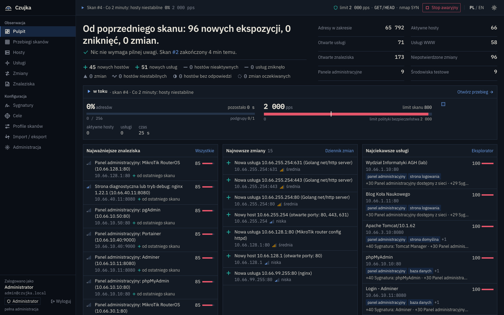

# Czujka: skaner, który rozumie czas

Czujka cyklicznie i bezpiecznie skanuje duże sieci (ponad 10 000 adresów): znajduje hosty, usługi, technologie WWW, panele, środowiska testowe, nagłówki i ciasteczka.
Uczy się tygodniowego rytmu każdego hosta, więc odróżnia „pracownia jest wyłączona na noc, jak zawsze” od „ten serwer zniknął”.
Wysyła tylko `GET` i `HEAD`, nigdy się nie loguje, a cały produkt to jedna binarka w Go i PostgreSQL z szyfrowaniem, uruchamiane jednym poleceniem.

Zgłoszenie do zadania „Attack Surface Intelligence” Centrum Bezpieczeństwa Informacji AGH, HackNation 2026. Zespół: Iwo Smura, Iwo Wojtakajtis.



## Dla jury

| Co | Gdzie |
| --- | --- |
| Prezentacja (10 slajdów) | [`docs/slides/czujka.pdf`](docs/slides/czujka.pdf) |
| Scenariusz demo, lista ujęć, pytania | [`docs/DEMO.md`](docs/DEMO.md) |
| Zgodność z treścią zadania: każde wymaganie, 12 punktów weryfikacji, 6 kryteriów, z dowodem | [`docs/ZGODNOSC.md`](docs/ZGODNOSC.md) |
| Wyniki zmierzone na laboratorium 70 hostów (precyzja, czułość, czas /16) | `docs/WYNIKI.md` (w przygotowaniu) |
| Działająca instancja z laboratorium 70 hostów | `https://czujka.dev`, konto do odczytu: dane logowania w zgłoszeniu |
| Spis całej dokumentacji | [`docs/DOKUMENTACJA.md`](docs/DOKUMENTACJA.md) |

## Szybki start

Wymagania: Docker z Compose v2; internet tylko przy pierwszym budowaniu.

```sh
git clone <adres repozytorium> czujka && cd czujka
docker compose -f deploy/docker-compose.yml up -d --build --wait
docker compose -f deploy/docker-compose.yml logs czujka | grep -A3 "first administrator"
```

Ostatnie polecenie pokazuje login (`admin@czujka.local`) i losowe hasło pierwszego administratora. Otwórz `http://127.0.0.1:8080`. Kreator prowadzi od logowania do pierwszego skanu w pięciu krokach (zmierzone: 19,9 s, `web/REPORT-LAB.md` §5).

Skanuj tylko sieci, do których masz uprawnienia.

## Teza: skaner, który rozumie czas

| Funkcja | Co daje | Szczegóły |
| --- | --- | --- |
| Rytm hosta | Histogram 168 godzin tygodnia i model Bayesa. Brak odpowiedzi w porze, w której host zwykle milczy, nie jest alarmem. Serwer, który zawsze odpowiadał, jest zgłaszany po 2 brakach; stacja robocza w weekend wcale. | [`docs/ALGORYTMY.md`](docs/ALGORYTMY.md) §2 |
| Ponowne sprawdzenia | Host, który zamilkł, dostaje krótkie sprawdzenia jednego adresu (po 10, 30, 90 min) albo w godzinie, w której model spodziewa się odpowiedzi. Budżet adresów na godzinę, tylko w oknie skanu. | [`docs/API.md`](docs/API.md) |
| Wehikuł czasu | Sieć taka, jaka była w dowolnym przebiegu: hosty, usługi, znaleziska i różnica do dziś. | ekran „Wehikuł czasu” |
| Reguły ekspozycji | Czego w sieci być nie może (albo co musi być), w YAML; sprawdzane po każdym skanie, bez pakietów. | [`docs/REGULY.md`](docs/REGULY.md) |
| Retro-hunt i sygnatura z przykładu | Nowa sygnatura sprawdza zapisaną historię bez wysyłania sond; jeden klik na usłudze proponuje sygnaturę z jej rzadkich cech. | [`docs/SIGNATURES.md`](docs/SIGNATURES.md), [`docs/REGULY.md`](docs/REGULY.md) §10 |

Skaner jest bezpieczny z konstrukcji. Wysyła tylko `GET` i `HEAD`, a walidator odrzuca sygnatury z inną metodą, treścią albo hasłem. Limity polityki zawsze wygrywają z profilem, skan staje na końcu okna czasowego, a stop awaryjny zatrzymuje wszystko: wywołanie trwało 0,06 s i po sekundzie nie działał żaden proces nmap ([`docs/BEZPIECZENSTWO.md`](docs/BEZPIECZENSTWO.md)).

Wdrożenie to jedno polecenie. Produkt to dwa kontenery: binarka z interfejsem WWW i nmapem oraz PostgreSQL z `pg_tde`; Kubernetes nie jest potrzebny ([`docs/WDROZENIE.md`](docs/WDROZENIE.md)).

## Stan

Produkt działa od końca do końca: `e2e/full/run.sh` przechodzi 52 z 52 sprawdzeń przez REST API na prawdziwych usługach (zapis: `e2e/full/transcript.txt`). Interfejs sprawdzono na laboratorium /16 z 70 hostami (`web/REPORT-LAB.md`). Dokładny stan każdego wymagania: [`docs/ZGODNOSC.md`](docs/ZGODNOSC.md).

Czego jeszcze brakuje:

- liczb precyzji i czułości na 70 hostach (`docs/WYNIKI.md`, w toku);
- ponownego pomiaru liczby pakietów w teście e2e: przechwytywanie `tcpdump -Q out` nie widziało pakietów z surowego gniazda nmap, więc średnie tempo i „0 pakietów” z `e2e/full/transcript.txt` są niepotwierdzone;
- zakresów CIDR IPv6 (pojedyncze adresy IPv6 działają);
- zapisu wysyłki z ekranu produktu do żywego DefectDojo (pliki i API sprawdzone osobno, `docs/INTEGRACJE.md` §4.11).

## Uruchomienie: szczegóły

Sprawdzenie stanu:

```sh
curl -s http://127.0.0.1:8080/healthz
# {"status":"ok","tde":true,"engine":true,"probe":{"mode":"nmap-raw","prober":"nmap","raw_sockets":true},...}
```

`"tde":true` oznacza, że wszystkie tabele są zaszyfrowane. `"mode":"nmap-raw"` oznacza nmap z surowymi gniazdami w kontenerze bez roota.

- Port zajęty: `CZUJKA_PORT=18080 docker compose -f deploy/docker-compose.yml up -d --build --wait`.
- Własne hasła i klucz: `cp deploy/.env.example deploy/.env`, potem edycja.
- Skan sieci dockerowej (na macOS host nie ma trasy do kontenerów): `CZUJKA_SCAN_NETWORK=<sieć> docker compose -f deploy/docker-compose.yml -f deploy/docker-compose.scan-network.yml up -d --wait`.
- Laboratorium testowe 70 hostów: `lab/lab.sh up`, stany `lab/scenario.sh t0|t1|t2` ([`lab/README.md`](lab/README.md)).
- Zatrzymanie: `docker compose -f deploy/docker-compose.yml down` (dane zostają) albo `down -v` (usuwa dane i klucze).

Pełna instrukcja: [`docs/WDROZENIE.md`](docs/WDROZENIE.md).

### Sam silnik skanu, bez bazy

Wymaga Go 1.27. Z nmap w systemie używa nmap, bez niego własnego probera TCP.

```sh
go run ./cmd/scanprobe -targets 127.0.0.1 -ports 8080 -pps 50
# COMPLETED: 1/1 addresses, 1 hosts up, 1 open services, 25 packets (avg 1 pps, limit 50)
```

## Dokumentacja

| Dokument | Treść |
| --- | --- |
| [`docs/DOKUMENTACJA.md`](docs/DOKUMENTACJA.md) | spis całej dokumentacji |
| [`docs/ZGODNOSC.md`](docs/ZGODNOSC.md) | wymagania zadania, ich stan i dowody |
| [`docs/slides/`](docs/slides/), [`docs/DEMO.md`](docs/DEMO.md) | prezentacja, scenariusz demo i pytania jury |
| [`docs/WDROZENIE.md`](docs/WDROZENIE.md) | instalacja, zmienne, kopie, rotacja klucza, sieć, problemy |
| [`docs/BEZPIECZENSTWO.md`](docs/BEZPIECZENSTWO.md) | model bezpiecznego skanowania i ochrona danych |
| [`docs/ALGORYTMY.md`](docs/ALGORYTMY.md) | model dostępności, zmiany, ocena ciekawości, grupowanie |
| [`docs/SIGNATURES.md`](docs/SIGNATURES.md) | język sygnatur i tryb bezpieczny |
| [`docs/REGULY.md`](docs/REGULY.md) | reguły ekspozycji i sygnatura z przykładu |
| [`docs/INTEGRACJE.md`](docs/INTEGRACJE.md) | import, eksport, źródła pasywne, DefectDojo |
| [`docs/ARCHITECTURE.md`](docs/ARCHITECTURE.md), [`docs/API.md`](docs/API.md) | architektura i REST API (po angielsku) |
| [`docs/PROBLEM_DEFINITION.md`](docs/PROBLEM_DEFINITION.md) | treść zadania |

## Budowa

| Katalog | Zawartość |
| --- | --- |
| `cmd/czujka` | binarka produktu; `cmd/scanprobe`, `cmd/fpprobe`, `cmd/dojoprobe` to narzędzia do testów modułów |
| `internal/scan`, `probe`, `targets`, `sched`, `enginewire` | silnik skanu, nmap i prober własny, cele, harmonogram i okna, połączenie silnika z produktem |
| `internal/httpfp`, `sig`, `sigwire`, `sigsuggest`, `signatures/` | kolektor HTTP/TLS, silnik sygnatur, sygnatury w bazie, sygnatura z przykładu, biblioteka 386 sygnatur |
| `internal/analyze`, `timeline`, `reprobe`, `rules` | analiza i model dostępności, wehikuł czasu, ponowne sprawdzenia, reguły ekspozycji |
| `internal/report`, `interchange`, `passive`, `defectdojo` | raport, formaty wymiany, źródła pasywne, klient DefectDojo |
| `internal/store`, `crypto`, `auth`, `api`, `runner`, `wire`, `config` | baza i migracje, szyfrowanie, role, REST API, menedżer przebiegów, składanie produktu, konfiguracja |
| `web/` | interfejs: React, TypeScript, Vite; wbudowany w binarkę |
| `deploy/` | obraz i compose produktu |
| `lab/` | laboratorium 70 hostów (/16) z prawdą wzorcową i lokalny DefectDojo |
| `e2e/` | testy end-to-end: `e2e/full` (cały produkt), `e2e/score` (ocena względem prawdy wzorcowej) |

Testy:

```sh
make test               # gofmt, build, vet, testy jednostkowe
make test-integration   # to samo na PostgreSQL z pg_tde (docker)
make e2e-full           # cały produkt przez REST API na prawdziwych usługach (około 15 minut)
```

Technologie: Go, PostgreSQL 17 (dystrybucja Percona z `pg_tde`), nmap, chi, pgx, React. Tylko oprogramowanie bezpłatne i otwarte; bez płatnych API.
