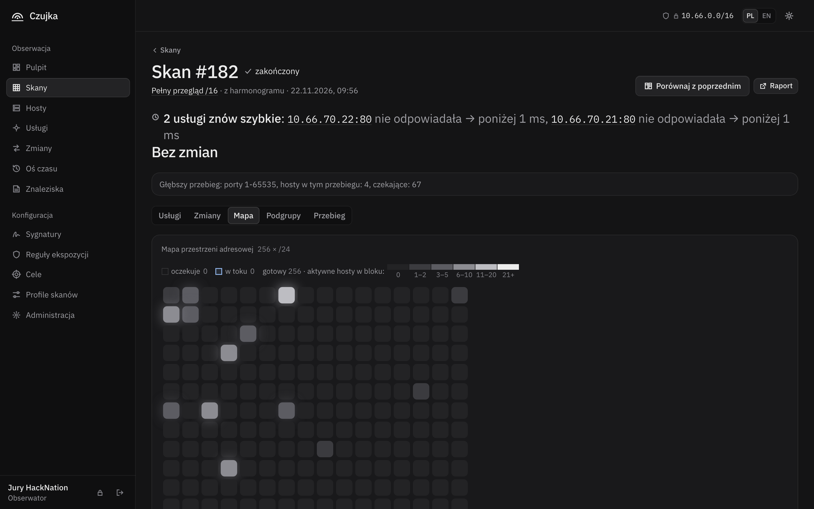
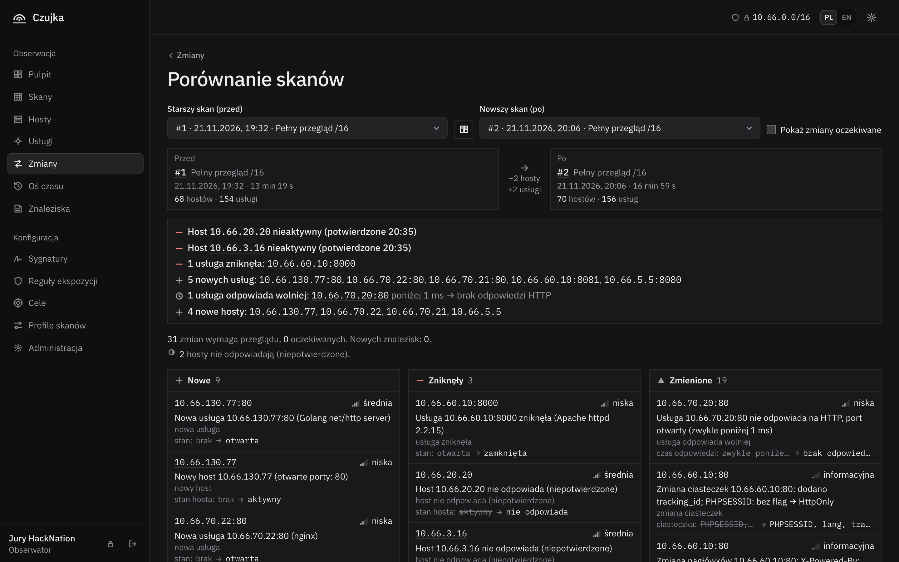
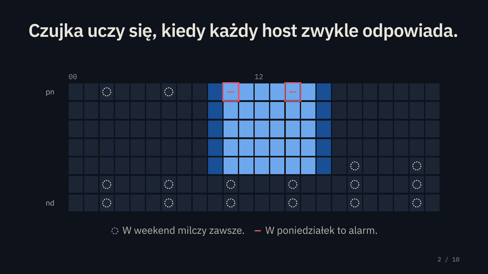
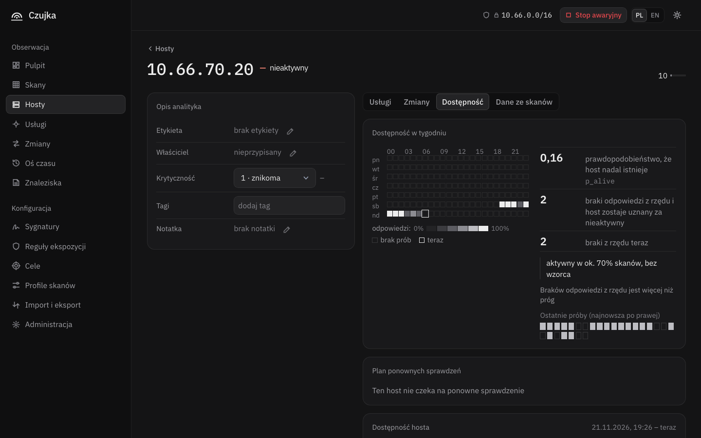
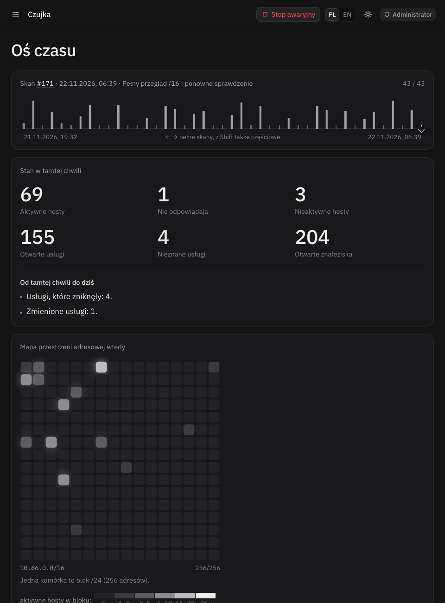
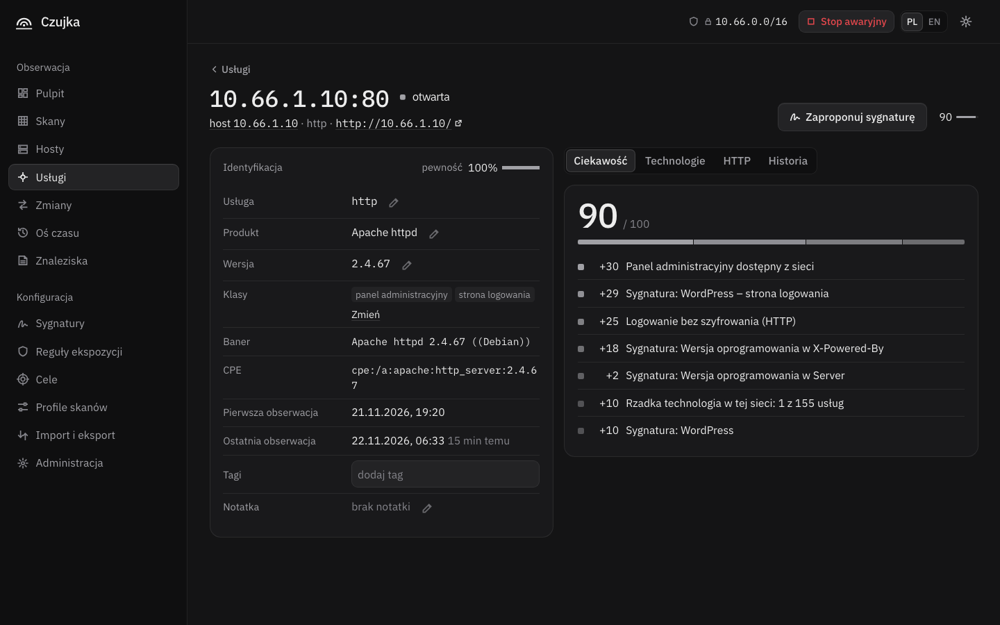
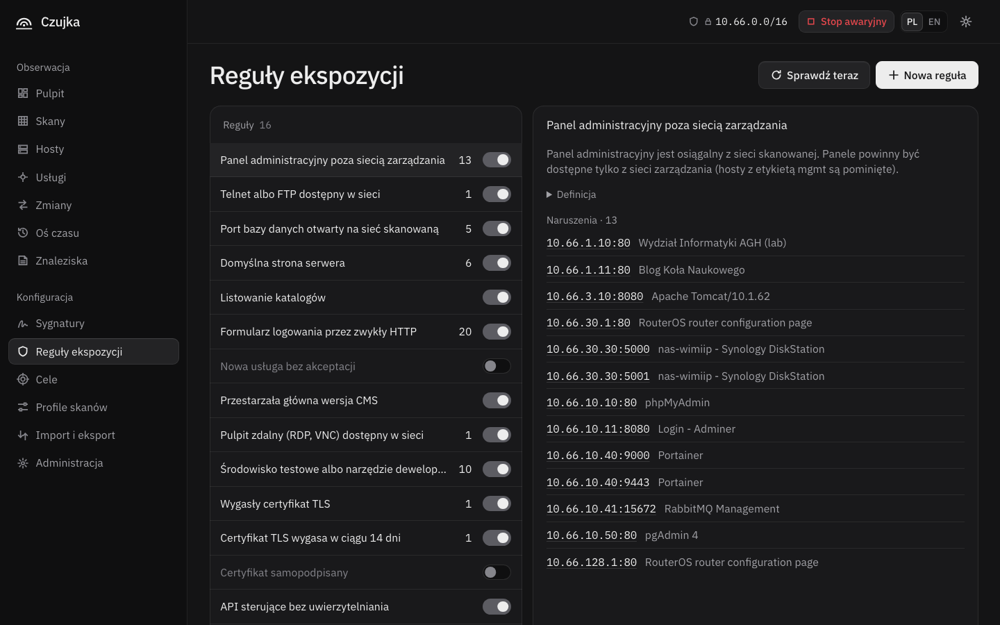
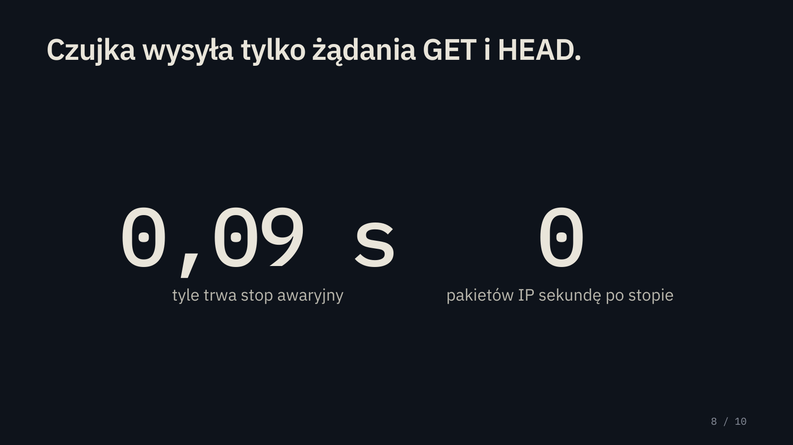
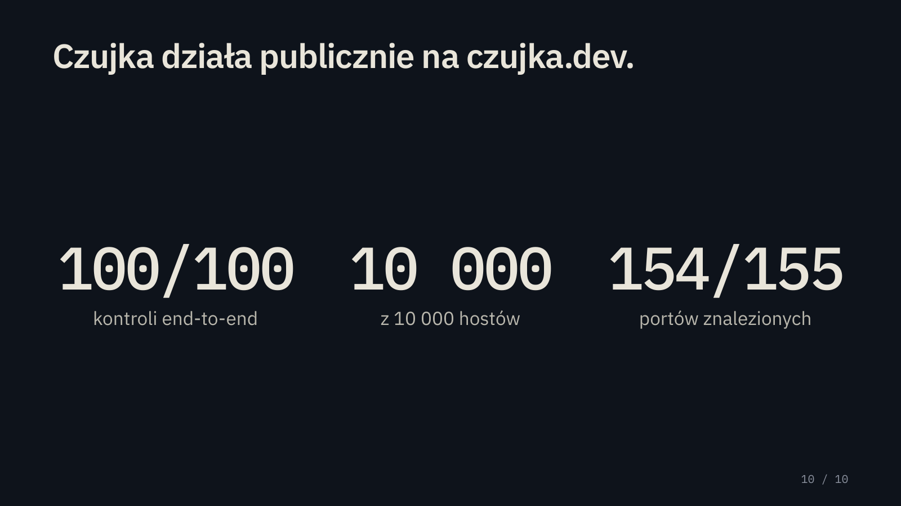

# Czujka

Czujka cyklicznie skanuje dużą sieć i po każdym skanie pokazuje, co się w niej zmieniło. Wysyła tylko `GET` i `HEAD` i nigdy się nie loguje.

**Działająca instancja: [czujka.dev](https://czujka.dev)** · [film (1:49)](docs/demo/czujka-demo.mp4) · [prezentacja (10 slajdów)](docs/slides/czujka.pdf) · [zgodność z zadaniem](docs/ZGODNOSC.md) · [wyniki pomiarów](docs/WYNIKI.md)

[](https://czujka.dev)

Zgłoszenie do zadania „Attack Surface Intelligence” Centrum Bezpieczeństwa Informacji AGH, HackNation 2026. Zespół Axion: Iwo Smura, Iwo Wojtakajtis.

## Zobacz na żywo

Instancja [czujka.dev](https://czujka.dev) skanuje co 30 minut laboratorium z 70 hostami w sieci /16 i ma historię skanów od 21.11. Jury ma cztery konta, po jednym na rolę (administrator, edytor, analityk, obserwator). Dane logowania i lista kroków do kliknięcia są w zgłoszeniu w HackTribe.

## Uruchom u siebie

```sh
git clone --depth 1 https://github.com/iwosmu/aghpen.git czujka && cd czujka
docker compose up -d
docker compose logs czujka | grep -A3 "first administrator"
```

Otwórz `http://127.0.0.1:8080`, zaloguj się danymi z logu, naciśnij **„Ten komputer”**, potem **„Uruchom skan”**. Czujka pokaże usługi na portach tego komputera, także kontenery Dockera z opublikowanymi portami. Kolejny skan pokaże, co zniknęło, co wróciło i co zwolniło.

<details>
<summary>Windows (Docker Desktop z WSL 2, PowerShell)</summary>

```powershell
git clone --depth 1 https://github.com/iwosmu/aghpen.git czujka; cd czujka
docker compose up -d
docker compose logs czujka | Select-String -Context 0,3 "first administrator"
```

Inny port ustawia `$env:CZUJKA_PORT=18080; docker compose up -d`. Repozytorium wymusza końce wierszy LF (`.gitattributes`), więc domyślne `core.autocrlf=true` z Git for Windows nie psuje skryptów w obrazach. Skrypt szablonu organizatorów (`lab/jury/quickstart.sh`) wymaga Git Bash albo WSL.

</details>

Skanuj tylko sieci, do których masz uprawnienia.

## Co widać w produkcie

### Skan całej sieci /16

Jeden przebieg obejmuje 65 536 adresów w 256 blokach po 256 adresów. Jaśniejszy kwadrat oznacza więcej aktywnych hostów w bloku. W laboratorium Czujka znajduje 67 z 67 hostów i 154 ze 155 otwartych portów.



### Zmiany między skanami

Porównanie dwóch skanów pokazuje usługi nowe, zniknięte i zmienione. Zmiany oczekiwane, na przykład pracownia wyłączona na noc, są domyślnie ukryte.



### Rytm hosta

Czujka zapisuje dla każdego hosta, w których ze 168 godzin tygodnia zwykle odpowiada. Brak odpowiedzi w godzinie, w której host zwykle milczy, nie jest alarmem. Serwer, który zawsze odpowiadał, Czujka zgłasza po 2 brakach i sprawdza ponownie tylko ten adres, po 10, 30 i 90 minutach ([`docs/ALGORYTMY.md`](docs/ALGORYTMY.md) §2).





### Oś czasu

Ekran „Oś czasu” pokazuje sieć po dowolnym wcześniejszym skanie: hosty, usługi, znaleziska i różnicę do dziś.



### Usługa, ocena i sygnatury

Każda usługa ma ocenę ciekawości z listą powodów i rozpoznane technologie. Biblioteka ma 416 własnych sygnatur i 1 831 pasywnych sygnatur z nuclei-templates. Przycisk „Zaproponuj sygnaturę” tworzy sygnaturę z wybranej usługi i testuje ją na zapisanej historii ([`docs/SIGNATURES.md`](docs/SIGNATURES.md)).



### Reguły ekspozycji

Reguła w YAML opisuje, czego w sieci być nie może. Czujka sprawdza reguły po każdym skanie na zapisanych wynikach, bez wysyłania pakietów ([`docs/REGULY.md`](docs/REGULY.md)).



### Bezpieczne skanowanie

Skaner wysyła tylko `GET` i `HEAD`. Walidator odrzuca sygnaturę z inną metodą, treścią albo hasłem. Limit pakietów z polityki ma pierwszeństwo przed profilem skanu, a drugi limit działa w jądrze systemu. Skan kończy się razem z oknem czasowym. Stop awaryjny trwał 0,09 s, a sekundę później nie działał żaden proces nmap i nie wyszedł żaden pakiet IP ([`docs/BEZPIECZENSTWO.md`](docs/BEZPIECZENSTWO.md)).



## Wyniki



Liczby pochodzą z [`docs/WYNIKI.md`](docs/WYNIKI.md). Pełna lista wymagań z dowodami jest w [`docs/ZGODNOSC.md`](docs/ZGODNOSC.md).

### Co sprawdzić i gdzie

| Obszar | Ekran albo polecenie | Zmierzone | Dowód |
| --- | --- | --- | --- |
| Discovery i identyfikacja usług w dużej sieci | przebieg /16 laboratorium; „Hosty”, „Usługi” | laboratorium: hosty 67 z 67, otwarte porty 154 ze 155, 0 fałszywych; skala: 10 000 z 10 000 żywych adresów, porty 22 500 z 22 500 | [WYNIKI](docs/WYNIKI.md#wykrywanie-w-sieci-16), `e2e/lab-gate.sh` |
| Uruchomienie, import/eksport, DefectDojo, dokumentacja | `docker compose up -d`; „Import i eksport”; „Znaleziska”, potem „Wszystkie do DefectDojo” | start 51–115 s; test szablonu jury 160 kontroli bez błędu; e2e 26 z 26 | [WYNIKI](docs/WYNIKI.md#uruchomienie), `e2e/full/transcript.txt`, `web/REPORT-LAB.md` §11 |
| Zmiany w czasie, niestabilne hosty, raport | szablon: `./quickstart.sh change` i drugi skan pokazują „Usługa zniknęła”; `up` pokazuje „Usługa wróciła”; zatrzymany host ma stan „nie odpowiada (niepotwierdzone)”, po około minucie „nieaktywny” | skan szablonu 49 s (`nmap -sV` na tych samych portach: 51 s) | [WYNIKI](docs/WYNIKI.md#szablon-organizatorów-jedna-maszyna), [ALGORYTMY](docs/ALGORYTMY.md) §3.4 |
| Bezpieczeństwo, tempo skanu, czytelny pulpit | górny pasek: „Stop awaryjny”; „Pulpit”: stopka „Tylko GET i HEAD” z limitami; „Administracja”, zakładka „Bezpieczeństwo” | żadnej sekundy ponad limit + 10% na /16; drugi limit w jądrze; stop w 0,09 s | [WYNIKI](docs/WYNIKI.md#tempo-i-bezpieczeństwo-skanowania), [BEZPIECZENSTWO](docs/BEZPIECZENSTWO.md) |
| Fingerprinting, technologie, nagłówki, ciasteczka, sygnatury | karta usługi, zakładka „Technologie”; lista „Usługi”, widok „Technologie”; „Sygnatury” | technologie: precyzja 1,000, czułość 0,990; tytuły 122 ze 122 | [WYNIKI](docs/WYNIKI.md#wykrywanie-w-sieci-16), [SIGNATURES](docs/SIGNATURES.md) |
| Role i ochrona danych | „Administracja”; `/healthz` zwraca `"tde":true` | 4 role i własne, 22 uprawnienia; `pg_tde` i AES-256-GCM | `TestRBACMatrixCSRFAndAudit`, [BEZPIECZENSTWO](docs/BEZPIECZENSTWO.md) §2 |

Produkt działa od końca do końca. Kontrola wydania na wersji końcowej: `make e2e-core` 26 z 26 (zapis: `deploy/e2e/transcript.txt`), test na szablonie organizatorów 160 kontroli bez błędu i 1 luka platformy (baner vsftpd pod Rosettą; `docs/TEST-JURY.md`). Wcześniejszy pełny test `e2e/full/run.sh`: 100 ze 100 (zapis: `e2e/full/transcript.txt`). Interfejs sprawdzono na laboratorium /16 z 70 hostami (`web/REPORT-LAB.md`). Dokładny stan każdego wymagania: [`docs/ZGODNOSC.md`](docs/ZGODNOSC.md).

Pomiary trafności, tempa i czasu startu: [`docs/WYNIKI.md`](docs/WYNIKI.md). Wysyłkę z ekranu produktu do żywego DefectDojo 3.5.202 zapisuje `web/REPORT-LAB.md` §11. Alerty: webhook po każdym przebiegu, zgodny z Slack i Mattermost, z podpisem HMAC ([`docs/API.md`](docs/API.md), „Alert webhook”).

## Test na szablonie organizatorów

Szablon `lab/jury` to jedna maszyna z usługami w Dockerze na portach hosta. Czujka działa w kontenerze, więc cel `localhost` (także `127.0.0.1` i `::1`) skanuje hosta dockera (`host.docker.internal`), a nie własny kontener. Podgląd celu pokazuje adres, pod którym cel jest skanowany. Szablon zajmuje port 8080, dlatego Czujka dostaje port 9180.

```sh
git clone --depth 1 https://github.com/iwosmu/aghpen.git czujka && cd czujka
CZUJKA_PORT=9180 docker compose up -d
docker compose logs czujka | grep -A3 "first administrator"
cd lab/jury && ./quickstart.sh up
```

1. Otwórz `http://127.0.0.1:9180` i zaloguj się danymi z logu.
2. Naciśnij „Ten komputer” i „Uruchom skan”. Mały zakres (jeden komputer) profil domyślny skanuje pełnym zakresem portów, więc znajduje też porty szablonu spoza top 1000. Na komputerze z innymi programami nie skanuj `localhost` pełnym zakresem portów: sondy wykrywania wersji trafiają wtedy także w lokalne usługi tych programów.
3. Wykonaj `./quickstart.sh change`, uruchom drugi skan („Skany”, „Uruchom skan”, profil „Ten komputer: …”). Czujka pokaże „Usługa …:8787 zniknęła”. Wykonaj `./quickstart.sh up`, skanuj trzeci raz. Czujka pokaże „Usługa …:8787 wróciła” z czasem nieobecności i liczbą skanów bez niej.

Czujka zapisuje czas odpowiedzi HTTP każdej usługi i porównuje go z jej własną bazą (mediana ostatnich 5 pomiarów). Odpowiedź co najmniej 2 razy wolniejsza i dłuższa o co najmniej 300 ms to zmiana „Wolniejsza odpowiedź”. Powrót do normy to „Odpowiedź w normie”. Na stosie `modern-proxy` skanuj raz bez opóźnienia i raz z `ENABLE_LATENCY=true` w `.env`. Port otwarty, na którym HTTP nie odpowiada w czasie, to „HTTP nie odpowiedział”, a nie zniknięcie usługi.

Usługa Czujki na porcie 9180 hosta dockera ma tag `czujka` i nie daje znalezisk. Na Linuksie można też uruchomić Czujkę w sieci hosta (`deploy/docker-compose.host-network.yml`, [`docs/WDROZENIE.md`](docs/WDROZENIE.md) §2.5).

Pomiar na każdym z czterech stosów szablonu: [`docs/TEST-JURY.md`](docs/TEST-JURY.md).

## Ograniczenia

- Zakresy CIDR IPv6 są odrzucane; pojedyncze adresy IPv6 działają. Nazwy domen dają tylko adresy IPv4 (rekordy A).
- UDP: tylko 7 portów z niegroźnymi zapytaniami (53, 123, 137, 161, 500, 1900, 5353). Wersję usługi UDP podaje `nmap -sU -sV` z najniższą intensywnością, tylko na otwartych portach z tej listy.
- REST API działa z sesją i tokenem CSRF; nie ma tokenów API. Skrypt loguje się jak przeglądarka: [`docs/API.md`](docs/API.md), „API with curl”. Logowanie nie ma drugiego składnika.
- Skala jest zmierzona na serwerze OMEN: 2 000 i 10 000 żywych adresów (2 i 10 kontenerów po 1 000 adresów) w sieci /16 ([`docs/WYNIKI.md`](docs/WYNIKI.md#skala-2-000-i-10-000-żywych-hostów)); czas dla innej liczby hostów to ekstrapolacja z tych pomiarów.

## Szczegóły

<details>
<summary>Czasy startu na czystej maszynie</summary>

Pomiar w `docker:dind` bez żadnych obrazów. Zapis: [`deploy/e2e/fresh-clone-dind.txt`](deploy/e2e/fresh-clone-dind.txt).

| Krok | Czas |
| --- | --- |
| `git clone --depth 1` | 10 s (45 MB na dysku; pomiar 22.11 na łączu domowym) |
| `docker compose up -d` do zdrowego API (pobranie obrazów i budowa) | 51–115 s, zależnie od łącza (trzy pomiary: 79 s z Docker Hub, 115 s i 51 s przez mirror.gcr.io) |
| zamiast tego paczka offline (`make bundle`, 354 MiB): rozpakowanie i `sh install.sh` | 26–29 s, bez sieci |
| logowanie, „Ten komputer”, „Uruchom skan” (przeglądarka sterowana skryptem) | 9 s |
| „Ten komputer”, profil domyślny, wszystkie 65 535 portów (szablon organizatorów, cztery stosy) | pierwsza usługa po 3–8 s, koniec po 88–101 s ([`docs/TEST-JURY.md`](docs/TEST-JURY.md)) |
| skan szablonu organizatorów (sześć portów z `quickstart.sh`, czysty Ubuntu 24.04) | 49 s; `nmap -Pn -sV` na tych samych portach: 51 s ([`docs/WYNIKI.md`](docs/WYNIKI.md#szablon-organizatorów-jedna-maszyna)) |

Nie trzeba `.env`: hasło bazy i klucz główny powstają przy pierwszym starcie w wolumenach, a losowe hasło administratora pojawia się raz w logu. Własne wartości: `make init` zapisuje `deploy/.env`, który `docker compose up -d` też czyta.

</details>

<details>
<summary>Uruchomienie, konfiguracja, kopie zapasowe</summary>

Sprawdzenie stanu:

```sh
curl -s http://127.0.0.1:8080/healthz
# {"status":"ok","tde":true,"engine":true,"probe":{"mode":"nmap-raw","prober":"nmap","raw_sockets":true},...}
```

`"tde":true` oznacza, że wszystkie tabele są zaszyfrowane. `"mode":"nmap-raw"` oznacza nmap z surowymi gniazdami w kontenerze bez roota.

- Port zajęty: `CZUJKA_PORT=18080 docker compose up -d`.
- Po zmianie kodu wystarczy `docker compose up -d`: obraz Czujki ma `pull_policy: build`, więc compose buduje go przy każdym `up` (niezmienione warstwy idą z pamięci podręcznej).
- Własne hasła i klucz: `cp deploy/.env.example deploy/.env`, potem edycja. `docker compose up -d` w katalogu głównym czyta `deploy/.env` (plik `compose.yaml` włącza `deploy/docker-compose.yml`); `docker compose -f deploy/docker-compose.yml …` działa jak dotąd.
- Skan sieci dockerowej (na macOS host nie ma trasy do kontenerów): `CZUJKA_SCAN_NETWORK=<sieć> docker compose -f deploy/docker-compose.yml -f deploy/docker-compose.scan-network.yml up -d --wait`.
- Laboratorium testowe 70 hostów: `lab/lab.sh up`, stany `lab/scenario.sh t0|t1|t2` ([`lab/README.md`](lab/README.md)).
- Własny `deploy/.env` jednym poleceniem: `make init` (losowe hasła i klucz główny, hasło administratora wydrukowane raz), potem `make up` albo `docker compose up -d`.
- Diagnoza instalacji: `docker compose -f deploy/docker-compose.yml exec czujka czujka doctor` (baza, `pg_tde`, klucz, nmap, surowe gniazda, tablica sąsiadów).
- Bez internetu: `make bundle` buduje paczkę z obrazami i instalatorem. Bez kontenerów: `make release` buduje statyczne binarki i plik usługi systemd.
- Kopia zapasowa: `czujka backup -o plik` i `czujka restore -i plik` (archiwum szyfrowane kluczem głównym).
- Zatrzymanie: `docker compose -f deploy/docker-compose.yml down` (dane zostają) albo `down -v` (usuwa dane i klucze).

Pełna instrukcja: [`docs/WDROZENIE.md`](docs/WDROZENIE.md).

### Sam silnik skanu, bez bazy

Wymaga Go 1.27. Z nmap w systemie używa nmap, bez niego własnego probera TCP.

```sh
go run ./cmd/scanprobe -targets 127.0.0.1 -ports 8080 -pps 50
# COMPLETED: 1/1 addresses, 1 hosts up, 1 open services, 25 packets (avg 1 pps, limit 50)
```

</details>

<details>
<summary>Budowa kodu i testy</summary>

Produkt to dwa kontenery: binarka w Go z interfejsem WWW i nmapem oraz PostgreSQL z `pg_tde`. Kubernetes nie jest potrzebny ([`docs/WDROZENIE.md`](docs/WDROZENIE.md)).

| Katalog | Zawartość |
| --- | --- |
| `cmd/czujka` | binarka produktu; `cmd/scanprobe`, `cmd/fpprobe`, `cmd/dojoprobe` to narzędzia do testów modułów |
| `internal/scan`, `probe`, `targets`, `sched`, `enginewire` | silnik skanu, nmap i prober własny, cele, harmonogram i okna, połączenie silnika z produktem |
| `internal/httpfp`, `sig`, `sigwire`, `sigsuggest`, `signatures/` | kolektor HTTP/TLS, silnik sygnatur, sygnatury w bazie, sygnatura z przykładu, biblioteka: 416 własnych sygnatur i 1 831 pasywnych sygnatur z nuclei-templates (MIT, `signatures/community/`) |
| `internal/analyze`, `timeline`, `reprobe`, `rules` | analiza i model dostępności, oś czasu, ponowne sprawdzenia, reguły ekspozycji |
| `internal/report`, `interchange`, `passive`, `defectdojo` | raport, formaty wymiany, źródła pasywne, klient DefectDojo |
| `internal/store`, `crypto`, `auth`, `api`, `runner`, `wire`, `config` | baza i migracje, szyfrowanie, role, REST API, menedżer przebiegów, składanie produktu, konfiguracja |
| `web/` | interfejs: React, TypeScript, Vite; wbudowany w binarkę |
| `deploy/` | obraz i compose produktu |
| `lab/` | laboratorium 70 hostów (/16) z prawdą wzorcową i lokalny DefectDojo |
| `e2e/` | testy end-to-end: `e2e/full` (cały produkt), `e2e/score` (ocena względem prawdy wzorcowej) |

Testy:

```sh
make test               # gofmt, build, vet, testy jednostkowe
make test-integration   # to samo na PostgreSQL z pg_tde (docker)
make e2e-full           # cały produkt przez REST API na prawdziwych usługach (około 15 minut)
```

Technologie: Go, PostgreSQL 17 (dystrybucja Percona z `pg_tde`), nmap, chi, pgx, React. Tylko oprogramowanie bezpłatne i otwarte; bez płatnych API.

</details>

## Dokumentacja

| Dokument | Treść |
| --- | --- |
| [`docs/DOKUMENTACJA.md`](docs/DOKUMENTACJA.md) | spis całej dokumentacji |
| [`docs/ZGODNOSC.md`](docs/ZGODNOSC.md) | wymagania zadania, ich stan i dowody |
| [`docs/slides/`](docs/slides/), [`docs/DEMO.md`](docs/DEMO.md), [`docs/demo/`](docs/demo/README.md) | prezentacja, scenariusz pokazu, film i skrypt, który go nagrywa |
| [`docs/WDROZENIE.md`](docs/WDROZENIE.md) | instalacja, zmienne, kopie, rotacja klucza, sieć, problemy |
| [`docs/BEZPIECZENSTWO.md`](docs/BEZPIECZENSTWO.md) | model bezpiecznego skanowania i ochrona danych |
| [`docs/ALGORYTMY.md`](docs/ALGORYTMY.md) | model dostępności, zmiany, ocena ciekawości, grupowanie |
| [`docs/SIGNATURES.md`](docs/SIGNATURES.md) | język sygnatur i tryb bezpieczny |
| [`docs/REGULY.md`](docs/REGULY.md) | reguły ekspozycji i sygnatura z przykładu |
| [`docs/INTEGRACJE.md`](docs/INTEGRACJE.md) | import, eksport, źródła pasywne, DefectDojo |
| [`docs/ARCHITECTURE.md`](docs/ARCHITECTURE.md), [`docs/API.md`](docs/API.md) | architektura i REST API (po angielsku) |
| [`docs/PROBLEM_DEFINITION.md`](docs/PROBLEM_DEFINITION.md) | treść zadania |

## Licencja

Kod Czujki: [MIT](LICENSE). Sygnatury z nuclei-templates: MIT, z zachowaną informacją o pochodzeniu ([`signatures/community/LICENSES.md`](signatures/community/LICENSES.md)). nmap jest osobnym programem uruchamianym przez Czujkę, na własnej licencji.
